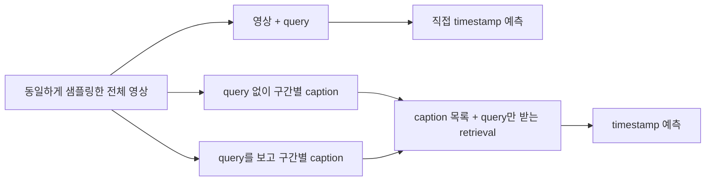

# Conversation archive

ID: 01a13f3f-a47e-7c80-9c2e-0be40df386d7

Title: Design query-conditioned captioning

## 2026-10-15T11:10:54.875Z — User

gt\_caption\_mr\_timelens

여기서 진행한 실험에서 하나 더 발전 시켜보려고 해. 실험 진행할 때는 DiT 끄고 gpu utilizaiton 최대화 해서 진행해.

우선은 설계만 해보자. 쿼리를 본 상태에서 캡셔닝을 시켰을 때와 동영상과 쿼리만 주어진 상태에서 direct timestamp prediction했을 때의 차이를 이용해서 modality gap이 있는지 확인해보고 싶거든? long video understanding에서 모든 visual token을 저장할 수는 없으니까 전부 캡션으로 바꾸는 거랑 비슷한 개념인데 query conditioned captiong을 해서 moment retrieval을 하게 바꾸는 거지. 내가 지금 좀 두서없이 말했는데 너가 정교하게 설계해봐


## 2026-10-15T11:13:55.310Z — Codex final report

제안하는 핵심 질문은 **“쿼리를 알고 영상을 텍스트로 압축하면, moment retrieval에 필요한 시각적·시간적 정보를 얼마나 보존할 수 있는가?”**입니다. 여기에 **“캡션을 거친 뒤 성능이 달라지는 이유가 정보 손실인지, 쿼리에 맞춘 정보 선택인지, 문제를 두 단계로 나눈 효과인지”**를 분리하는 실험을 붙이면 좋겠습니다.

단순히 caption 방식과 direct prediction의 점수 차이를 곧바로 modality gap이라고 부르기는 어렵습니다. 우선 **동일한 관측 정보에서 발생하는 video→text 경유 성능 차이**로 정의하고, 추가 분석으로 원인을 좁히는 설계를 권합니다.

기존 실험을 확인해 보니 출발점은 명확합니다. 현재는 GT crop을 query 없이 캡셔닝하고, 별도로 전체 영상과 query에서 timestamp를 예측합니다. 전체 direct retrieval의 R@1@0.5는 약 50.8%이고, 자동 judge가 caption에 query 정보가 모두 있다고 판정한 사례에서도 retrieval 실패율은 약 35.1%입니다. 다만 caption 쪽에는 **정답 구간을 미리 잘라 주었다는 이점**이 있어, 이 수치만으로 두 경로의 능력을 비교할 수는 없습니다. [기존 프로토콜](/home/irteam/experiments/gt_caption_mr_timelens/protocol.json), [결과](/home/irteam/experiments/gt_caption_mr_timelens/reports/summary.json)

이번에는 다음 세 경로가 모두 **전체 영상에서 출발해 최종 timestamp를 출력**하도록 바꾸겠습니다.

| 조건 | 처리 경로 | 확인하려는 것 |
|---|---|---|
| **D: Direct** | video + query → timestamp | 시각 정보를 직접 사용하는 기준선 |
| **C₀: Generic caption** | video → 시간 정보가 붙은 caption 목록 → query와 함께 timestamp 예측 | 일반적인 caption memory의 성능 |
| **Cq: Query-conditioned caption** | video + query → 시간 정보가 붙은 caption 목록 → query와 함께 timestamp 예측 | 질문에 필요한 정보를 선택적으로 보존하는 효과 |

C₀와 Cq의 마지막 retrieval 단계는 **같은 모델, 같은 프롬프트, 같은 출력 형식**을 사용합니다. Caption 생성 모델도 우선 기존 Qwen3-VL-8B로 통일합니다. 이렇게 해야 모델 교체 효과가 섞이지 않습니다.



**캡션은 영상 전체를 한 문장으로 요약하기보다, 시간 순서가 있는 작은 메모리로 만들겠습니다.** 한 문단으로 압축하면 사건이 빠진 것과 시간 위치가 사라진 것을 구분하기 어렵습니다.

초기 설정은 다음처럼 잡을 수 있습니다. 수치는 pilot에서 검증할 시작값입니다.

- 전체 영상을 **2초 단위 core 구간**으로 나누고, 앞뒤 1초를 포함한 최대 4초 영상을 보여줍니다.
- 각 caption은 주변 맥락을 참고하되 **core 구간에서 관측된 사실만** 기술합니다.
- 구간의 시작·끝 시간은 코드가 붙입니다. Captioner가 정답 event의 시작·끝을 출력하지는 않습니다.
- C₀와 Cq 모두 모든 구간을 처리하며, 동일한 caption token 상한을 적용합니다. 초기 상한은 구간당 64 tokens로 두고 실제 길이도 기록합니다.
- 프레임은 전체 영상에서 한 번 샘플링한 공통 목록을 사용합니다. 짧은 chunk에만 프레임을 더 촘촘하게 넣지 않습니다.

예를 들어 query가 “사람이 냉장고 문을 닫는다”라면, Cq의 출력은 다음 정도입니다.

> `[12–14초] 사람이 열린 냉장고 문을 잡고 안쪽으로 민다. 구간 끝에서는 문이 거의 닫혀 있다.`

“이 구간이 정답이다”라는 판단 대신 **사람·대상·동작·상태 변화에 대한 관측 근거**를 남기게 합니다. 관련 행동이 보이지 않는 구간에서도 관측 사실을 기술하고, 억지로 query를 만족시키는 문장을 만들지 않도록 합니다.

마지막 retrieval은 이 caption 목록만 보고 구간을 선택합니다. **이전 영상의 visual token이나 KV cache가 넘어가지 않는 독립 요청**이어야 합니다. 그래야 실제로 텍스트 메모리만으로 복원한 성능을 측정할 수 있습니다.

여기서 측정할 차이는 두 가지입니다.

\[
\Delta_{\text{conditioning}} = S(C_q)-S(C_0)
\]

이는 같은 caption 예산에서 **query를 미리 아는 것이 얼마나 도움이 되는지**를 보여줍니다.

\[
\Delta_{\text{route}} = S(C_q)-S(D)
\]

이는 **직접 예측과 query-conditioned text 경유 방식의 최종 성능 차이**입니다. 양수여도 텍스트가 본질적으로 우월하다는 뜻은 아닙니다. 구간별로 집중해서 보고, 판단을 두 단계로 나눈 효과가 포함되기 때문입니다.

이 차이를 해석하려면 아래 통제가 필요합니다.

| 통제·진단 | 구체적인 방법 | 해소하는 의문 |
|---|---|---|
| **GT 비노출** | chunk 경계는 고정 규칙으로 생성. GT는 평가에만 사용 | 정답 위치를 미리 알려준 효과인가? |
| **구간화 효과** | D와 별도로, 동일한 chunk를 보고 query의 관측 근거·관련성을 판단한 뒤 전체 구간을 결정하는 visual baseline 추가 | 캡션보다 짧은 문맥으로 나눈 것이 효과적인가? |
| **시간 해상도** | 공통 시간 격자에서의 평가와 자유로운 timestamp 평가를 분리 | 사건을 놓쳤는가, 경계가 거칠어진 것인가? |
| **Query 유도 환각** | 검증된 비관련 query 또는 최소한으로 바꾼 query를 captioner에 제공하는 대조군 | query를 보고 없는 사건을 만들어 내는가? |
| **영상 재제공** | Cq가 실패한 사례에 caption과 영상을 함께 제공하고 다시 예측 | 텍스트에서 빠진 시각 정보로 회복되는가? |

특히 **시간 해상도 통제**는 중요합니다. 기존 데이터는 GT 길이가 5초 미만인 query가 2,064개라서, 2초 단위 caption만으로는 사건을 제대로 찾아도 IoU가 낮아질 수 있습니다.

따라서 먼저 같은 시간 격자로 표현한 예측끼리 비교하고, 그 격자에서 GT에 가장 잘 맞출 수 있는 **oracle 최고 IoU**도 계산하겠습니다. 이 oracle은 평가 때만 사용합니다. 이후 자유로운 timestamp 출력으로 실제 사용 성능을 봅니다. 필요하면 1초 core를 추가해 경계 해상도의 영향을 확인합니다.

또 **caption과 query의 문장 유사도 상승을 이해도 상승으로 취급하면 안 됩니다.** Cq는 query를 이미 봤으므로 query 표현을 그대로 반복하기 쉽습니다. 기존 text-only judge는 “필요한 사실이 문장에 남아 있는가”를 보조적으로 측정하는 데 쓰고, 실제로 영상에 존재하는 사실인지는 별도 검토가 필요합니다. 기존 정성 검토에도 핵심 누락, 동작 반전, 환각, GT 경계 문제 등이 기록돼 있습니다. [정성 검토 기록](/home/irteam/experiments/gt_caption_mr_timelens/reports/pilot/qualitative_review/summary.json)

결과 분석은 평균 점수와 함께 **같은 query에서 어느 경로만 성공했는지**를 보겠습니다.

| Direct | Cq | 우선 검토할 해석 |
|---|---|---|
| 성공 | 실패 | caption의 핵심 정보 누락, 순서·경계 정보 손실, text retriever 오류 |
| 실패 | 성공 | 명시적인 언어화와 단계 분리가 localization에 도움 |
| 실패 | 실패 | 공통 인식 실패, 샘플링 문제, query·GT 모호성 |
| 성공 | 성공 | 해당 예산의 caption으로 retrieval 정보를 보존 가능 |

실패 사례에서는 순서대로 확인합니다. **필요한 사실이 caption에 남아 있는지 → 올바른 시간 구간에 기록됐는지 → 남아 있는 정보를 retriever가 제대로 사용했는지**입니다. 이 세 단계가 각각 정보 누락, 시간 정보 손실, 후단 추론 오류에 대응합니다.

주 지표는 기존과 연결되는 **R@1@0.5**, 보조 지표는 R@1@0.3/0.7, mIoU, 시작·끝 오차로 두겠습니다. 성능 차이의 신뢰구간은 같은 영상에 여러 query가 있다는 점을 고려해 **video 단위 paired bootstrap**으로 계산합니다. 파싱 실패도 전체 분모에 포함하고, judge 실패 때문에 MR 평가 대상이 줄어들지 않게 합니다.

Long-video 쪽에서는 먼저 **query가 언제 주어지는가**를 명확히 해야 합니다.

- **Query를 알고 영상을 읽는 경우:** Cq를 만들면서 처리한 visual token을 버릴 수 있습니다. 이번 실험의 직접적인 적용 대상입니다.
- **영상을 이미 압축한 뒤 새로운 query가 오는 경우:** Cq를 새로 만들려면 영상을 다시 읽어야 합니다. 재접근이 불가능하다면 C₀ 같은 query-independent memory가 필요합니다.

따라서 Cq의 메모리 절약을 주장할 때는 **query마다 다시 캡셔닝하는 비용**도 함께 보고해야 합니다. 일반 caption은 여러 query에서 재사용할 수 있으므로, query 1개와 여러 개일 때의 총비용을 분리하겠습니다.

또 caption을 계속 쌓으면 텍스트 메모리도 길이에 비례해 증가합니다. Long-video 확장에서는 **구간당 caption 예산**뿐 아니라 **영상 전체에 남길 text memory 총량**을 제한한 조건이 필요합니다. 평가에는 정확도와 함께 다음을 기록합니다.

- 실제 저장한 caption token 수와 저장 bytes
- peak GPU memory와 유지하는 visual/KV memory
- caption 생성부터 최종 예측까지의 총시간
- query당 처리량과 영상 재독해 횟수

현재 Charades-TimeLens 영상은 중앙값 약 31초, 최대 약 72초이므로 여기서는 메커니즘을 검증하고, 실제 긴 영상에서 길이·메모리 예산별 성능 곡선을 추가하는 것이 맞습니다. 짧은 영상을 이어 붙인 실험은 방해 사건과 위치 편향을 통제하는 보조 실험으로 쓸 수 있지만, 실제 long-video 검증은 별도로 두겠습니다.

실행 순서는 **기존 pilot 100개에서 D/C₀/Cq와 통제 조건을 점검하고, 설정을 고정한 뒤 나머지 영상으로 평가**하는 것을 권합니다. Pilot에서 설정을 조정했다면 같은 영상의 다른 query도 최종 holdout에서 제외합니다. 전체 3,363개 결과는 기존 실험과의 비교용으로 별도 보고할 수 있습니다.

연구 기여도 “caption으로 retrieval한다”보다 **query conditioning이 제한된 텍스트 메모리에서 무엇을 보존하고 무엇을 잃게 하는지 측정한다**에 두는 편이 좋습니다. 구간 caption을 query와 매칭하는 접근 자체는 [ChatVTG](https://arxiv.org/abs/2410.12813)에도 있습니다.

이번에는 설계만 진행했고 실행이나 프로세스 변경은 하지 않았습니다. 이후 실행할 때는 요청대로 **DiT를 종료한 뒤 GPU 메모리 반환을 확인**하고, 길이별 batching·영상 decode prefetch·동적 작업 배분으로 처리량을 높이겠습니다. 기존의 H200 4-worker 설정을 출발점으로 삼되, GPU utilization과 실제 samples/sec를 함께 측정해 동시성을 정하겠습니다.

## 2026-10-15T11:25:32.863Z — User

Charades-timelens 3천여개 샘플 중에 2천개가 5초 미만이라고?


## 2026-10-15T11:26:25.775Z — User

1초 단위 샘플링은 어떤데. qwen3 입력이 2fps니까 딱 절반 정도. 많이 부담스럽나?


## 2026-10-15T11:27:09.407Z — Codex final report

**1초 간격은 충분히 검토할 만합니다. 다만 프레임 샘플링인지, 캡션 생성 간격인지에 따라 비용이 달라집니다.**

| 의미 | 30초 영상 예시 | 비용 변화 |
|---|---|---|
| **1fps로 프레임 샘플링** | 60프레임 → 30프레임 | 해상도를 고정하면 시각 입력량은 대략 절반 |
| **2fps를 유지하면서 1초마다 캡션 생성** | 1초 구간마다 2프레임 사용 | 2초마다 생성할 때보다 caption 요청 수가 약 2배 |

내가 앞서 제안한 **2초 단위 caption을 1초 단위로 좁히자는 의미라면, 이 데이터에서는 그쪽이 더 적절해 보입니다.** 다시 집계해 보니 3,363개 query 중 **GT 구간이 5초 미만인 것은 2,064개이고, GT 길이 중앙값은 3초**입니다. 전체 영상 길이가 짧다는 뜻은 아닙니다.

다만 1초에 들어 있는 2프레임만 따로 보여주면 동작을 판단할 맥락이 부족할 수 있습니다. 그래서 다음 구성을 추천합니다.

- **입력은 기존 2fps 유지**
- **caption을 기록하는 단위는 1초**
- **앞뒤 1초를 더해 총 3초의 문맥을 보여주고**, 가운데 1초에서 일어난 사실을 기술
- 인접 구간의 decode 결과를 재사용하고, 여러 구간을 batch로 처리

이렇게 하면 캡션 요청 수와 중복 영상 인코딩 비용은 늘지만, **전체 실험이 정확히 2배 느려진다는 뜻은 아닙니다.** 짧은 입력을 batching할 수 있으므로 pilot에서 처리량을 측정해야 합니다. 설계 단계에서 부담 때문에 제외할 정도는 아닙니다.

반대로 **정말 프레임 자체를 1fps로 낮추자는 뜻이라면**, 계산량은 줄일 수 있지만 짧은 동작의 시작·끝을 놓치는 효과가 modality 비교에 섞입니다. 주 실험은 2fps로 유지하고, 1fps는 효율 비교 조건으로 두는 게 좋겠습니다. 또한 현재 코드는 프레임 수가 줄면 프레임당 해상도를 높일 수 있는 구조라서, **FPS만 절반으로 바꿔서는 visual token 수도 절반이 된다고 보장할 수 없습니다.** 해상도까지 고정해야 그 비교가 가능합니다.

## 2026-10-15T11:28:21.826Z — User

동영상을 구간 단위로 분할하는 것은 몇 초 단위가 적절해보여? [https://github.com/choi-yeeun/MERIT](https://github.com/choi-yeeun/MERIT) 이거는 세팅이 long video이긴한데 30초 단위로 분할했고 그 30초씩 캡셔닝을 하거든? 여기서 캡셔닝은 어떻게 했는지 알아봐


## 2026-10-15T11:30:45.334Z — Codex final report

**현재 Charades-TimeLens에서는 4초 단위로 영상을 넣고, 캡션 안에는 1초 단위 시간 정보를 남기는 구성을 추천합니다.** MERIT의 코드와 논문을 확인하니, 30초는 긴 영상에서 검색할 메모리 단위이고, 우리처럼 짧은 사건의 시작·끝을 정확히 맞히는 설정과는 차이가 있습니다.

먼저 MERIT의 캡셔닝은 다음과 같습니다.

| 항목 | 확인한 설정 |
|---|---|
| 영상 분할 | 겹치지 않는 **30초 구간** |
| 프레임 샘플링 | **1fps**, 완전한 30초 구간당 30프레임 |
| 캡셔닝 모델 | **GPT-5-mini** |
| Query 제공 | **제공하지 않음**. 질문을 받기 전에 메모리 생성 |
| 출력 | 정보를 상세히 담은 **한 문단**, Video-MME/LVBench 프롬프트는 약 **120–220 words** 요구 |
| 시간 정보 | 캡션 본문에는 timestamp를 넣지 않고, 구간 시작·끝을 별도 metadata로 저장 |

30초 분할·1fps는 [프레임 추출 코드](https://github.com/choi-yeeun/MERIT/blob/main/benchmarks/videomme/preprocess/sample_frames.py), 모델과 입력 구성은 [캡셔닝 코드](https://github.com/choi-yeeun/MERIT/blob/main/benchmarks/videomme/preprocess/caption_clips.py)에서 확인했습니다.

다만 **데이터셋마다 캡션을 만드는 경로가 다릅니다.**

- **Video-MME:** 시간순 프레임들과 해당 30초에 겹치는 자막을 함께 입력합니다. 등장인물, 사건, 발화, 중요한 시각적 세부를 통합하되 추측하지 않도록 지시합니다. [프롬프트](https://github.com/choi-yeeun/MERIT/blob/main/benchmarks/videomme/prompt/captioning_gpt5_prompt.txt)
- **LVBench:** 자막 없이 프레임만 입력합니다. 보이는 인물·행동·세부 정보를 설명하고, timestamp와 구간 길이는 쓰지 않도록 합니다. [프롬프트](https://github.com/choi-yeeun/MERIT/blob/main/benchmarks/lvbench/prompt/captioning_gpt5_prompt.txt)
- **EgoLife:** MERIT README는 **WorldMM에서 공개한 캡션을 재사용**한다고 명시합니다. 연결된 WorldMM 전처리 코드는 기존 visual caption과 transcript를 GPT-5-mini로 합쳐, 착용자 관점의 1인칭 서술로 정리합니다. 따라서 이 경로를 “GPT-5-mini가 원본 30프레임을 직접 보고 생성했다”고 설명하면 부정확합니다. [MERIT README](https://github.com/choi-yeeun/MERIT#preprocessing), [WorldMM 코드](https://github.com/wgcyeo/WorldMM/blob/main/preprocess/episodic_memory/generate_fine_caption_egolife.py)

**MERIT에서 query conditioning은 캡션을 만든 다음에 일어납니다.** 캡션에서 event/action, dialogue, object, summary 키를 추출해 검색하고, 검색된 구간 주변의 캡션을 모아 질문에 필요한 내용을 추립니다. 그리고 최종 답변 단계에서는 **검색된 구간의 영상 프레임도 다시 제공합니다.** 그래서 MERIT의 결과를 “영상 정보를 완전히 버리고 caption만으로 풀어도 된다”는 근거로 사용할 수는 없습니다. [논문 §3 및 Appendix A](https://arxiv.org/html/2608.07663v1)

우리 실험에서 가져올 부분은 **구간별로 충분한 문맥을 보고 상세한 서술을 만든다**는 점입니다. 반면 **구간 내부 시간 정보를 제거하는 부분은 바꿔야 합니다.**

현재 GT 구간의 중앙값은 3초입니다. 예를 들어 30초 caption에 “냉장고를 열고 물을 꺼낸 뒤 문을 닫는다”가 정확히 적혀 있어도, 문을 닫은 시점이 8초인지 24초인지는 복원하기 어렵습니다. 여기서 발생하는 실패에는 시간 정보 제거의 영향이 크게 섞입니다.

이를 확인하려고 모델 추론 없이 기존 annotation으로 **시간 격자만의 성능 상한**을 계산했습니다. 예측의 시작·끝을 `0, Δ, 2Δ, …, 영상 끝` 중에서만 고르게 하고, GT를 아는 oracle이 가장 좋은 연속 구간을 선택한 결과입니다.

| 허용하는 경계 간격 Δ | Oracle R@1@0.5 | Oracle R@1@0.7 |
|---|---:|---:|
| 1초 | 100.0% | 100.0% |
| 2초 | 100.0% | 68.6% |
| 4초 | 72.1% | 45.2% |
| 5초 | 56.4% | 35.7% |
| 8초 | 42.5% | 23.7% |
| 30초 | 10.6% | 4.4% |

이는 **chunk 경계만 답으로 낼 때의 상한**입니다. Chunk 내부 시간을 예측할 수 있다면 이 제한은 적용되지 않습니다. 또한 1초에서 100%인 것은 현재 annotation을 그 격자로 표현할 수 있다는 뜻이지, 모델이 정확하게 맞힌다는 뜻은 아닙니다. [계산에 사용한 manifest](/home/irteam/experiments/gt_caption_mr_timelens/manifest.json)

그래서 앞서 이야기한 설정을 다음처럼 구체화하는 것이 좋겠습니다.

| 설계 요소 | 추천 시작값 |
|---|---|
| 한 번에 보여주는 영상 | **4초** |
| 기본 stride | **4초**, 우선 overlap 없이 |
| 프레임 입력 | 기존 **2fps**, 4초당 약 8프레임 |
| Caption 출력 | **1초 구간별 관측 서술**을 한 요청에서 생성 |
| Query 조건 | 같은 입력으로 query-free / query-conditioned 비교 |
| 마지막 retrieval | 시간 정보가 붙은 caption과 query만 사용 |

예를 들어 `[8, 12)`초 영상을 한 번 보여주고, 아래와 같은 텍스트 메모리를 만드는 방식입니다. 다음은 형식을 보여주기 위한 예시입니다.

```text
[8–9초] 사람이 열린 냉장고 앞에 서서 오른손으로 문을 잡는다.
[9–10초] 냉장고 문을 안쪽으로 밀기 시작한다.
[10–11초] 문이 닫히고 손을 문에서 뗀다.
[11–12초] 냉장고에서 몸을 돌려 이동한다.
```

**1초마다 독립적으로 모델을 호출하는 것과는 다릅니다.** 4초의 동작 흐름을 함께 보면서 시간별 서술을 생성하므로, 1초 입력만 주는 것보다 전후 상태를 파악할 여지가 있고 호출 수도 줄어듭니다. 다만 captioner 자체의 시간 배정 오류는 생길 수 있으므로, 내용 누락과 시간 배정 오류를 따로 평가해야 합니다.

Query-conditioned 조건에서는 해당 질문을 구분하는 행동·대상·상태 변화를 우선 기술하도록 하되, 정답 구간 선택은 뒤의 retriever가 하게 합니다. 같은 행동이 여러 초 이어지면 같은 사실이 반복되는 것도 허용하고, 매초 새로운 사건을 억지로 만들게 해서는 안 됩니다.

**4초가 최적이라고 확정할 근거는 아직 없으므로, pilot에서는 2초·4초·8초를 비교하는 것이 적절합니다.** 이때 출력 시간 해상도는 모두 1초로 고정하고, 영상 1초당 허용하는 caption token 예산도 맞추겠습니다. 그래야 구간을 잘게 나눈 조건이 단순히 더 많은 텍스트를 저장해서 유리해지는 것을 줄일 수 있습니다. 경계에서 사건이 잘리는 문제가 확인되면, 그다음에 4초 window / 2초 stride를 추가하면 됩니다.

현재의 추천은 **“4초 문맥을 보고, 1초 해상도의 텍스트 메모리를 만든다”**입니다. MERIT식 **30초당 한 문단·내부 timestamp 없음**은 비교용 압축 조건으로 두는 편이 이번 modality-gap 분석에 더 유용합니다.
